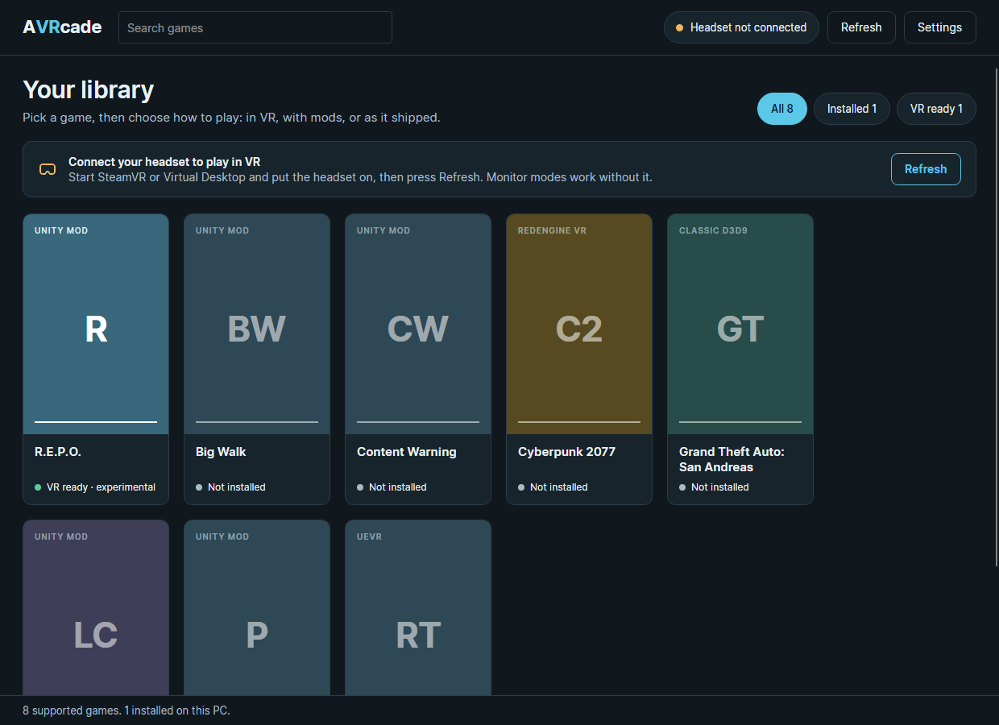
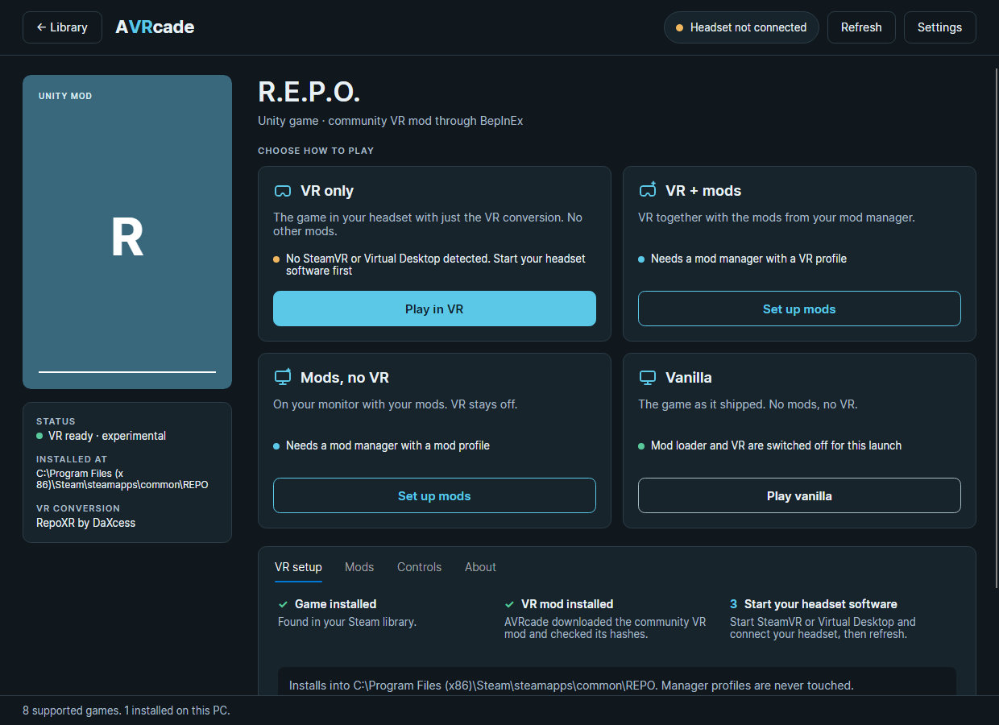
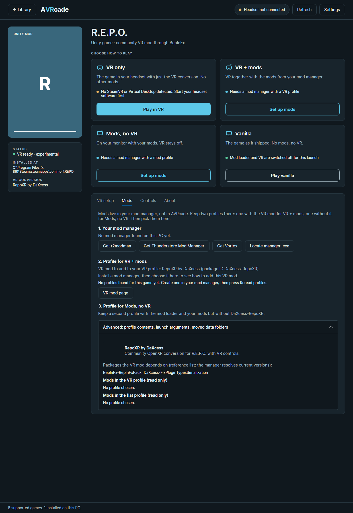

# AVRcade

Play the PC games you already own in VR from one library.

AVRcade finds your Steam games, sets up each game's VR conversion for you, and gives every game the same four launch buttons.

## Clean install of the latest Windows release

**[Download the latest AVRcade Windows installer (.exe)](https://github.com/Axleonex/AVRcade/releases/latest/download/AVRcade-Setup.exe)**

[Portable ZIP](https://github.com/Axleonex/AVRcade/releases/latest/download/AVRcade-win-x64.zip) · [SHA-256 checksums](https://github.com/Axleonex/AVRcade/releases/latest/download/SHA256SUMS.txt) · [Latest release notes](https://github.com/Axleonex/AVRcade/releases/latest) · [Report a problem](https://github.com/Axleonex/AVRcade/issues)

These permanent links select the latest published release, including its installer, portable ZIP and checksums. You can also choose the assets on the [latest release page](https://github.com/Axleonex/AVRcade/releases/latest).

1. **Download** the installer above. Choose the `.exe`, rather than GitHub's **Source code** ZIP.
2. **Run** `AVRcade-Setup.exe` and follow the setup wizard. It installs to `%LOCALAPPDATA%\Programs\AVRcade`; no administrator access is needed.
3. **Open AVRcade** from the Windows Start menu.

The app includes its .NET runtime. You do not need Git, Visual Studio, or a separate .NET installation.

The installer is unsigned. If Windows SmartScreen shows **Windows protected your PC**, check that you downloaded the file from this repository's release page. If you trust it, choose **More info → Run anyway**.

**Prefer a portable app?** Download the ZIP above, right-click it and choose **Extract All** into a new, empty folder, then run `AVRcade.exe` there. Keep the complete extracted folder together.

**Updating an existing installation?** Close AVRcade and run the latest installer. Your saved game selections and preferences are preserved. A clean application install does not require deleting your games, mod-manager profiles or saves.

> **v0.5.2 adds a Troubleshooting tab for each of the ten catalogue games, Steam game-file verification, native startup checks and clearer VR launch feedback.** YAPYAP still requires its separately prepared UUVR/AVRcade VR package; Escape the Backrooms requires its game-specific VR setup. See the [release notes](https://github.com/Axleonex/AVRcade/releases/latest) for details.

## What you need

- **Windows 10 (1809 or later) or Windows 11, 64-bit.**
- **[Steam](https://store.steampowered.com/about/) and a supported game you own and have installed.** AVRcade does not include or download games. For classic San Andreas, use **Locate installed game** to select your own copy.
- **A PC VR headset connected to your computer**, using [SteamVR (free)](https://store.steampowered.com/app/250820/SteamVR/) or [Virtual Desktop](https://www.vrdesktop.net/). Some games require SteamVR even when connected through Virtual Desktop.
- **Optional: a mod manager**, only for **VR + mods** and **Mods, no VR**. You can start with **VR only** without one when the game's required VR components are installed.

## First VR launch

1. Install a game supported by your AVRcade version through Steam.
2. Connect your headset and start SteamVR or Virtual Desktop. If both are running, AVRcade uses SteamVR.
3. Open the game's page in AVRcade and choose **VR only**. If its button offers **Install VR mod** or another setup step, complete that first, then press the play button when it becomes available. An internet connection is needed to download VR components.

If your game is missing, check that it is installed and supported by your version. If a launch is blocked, follow the reason shown on the game's page; some integrations require a specific game build.



## Four ways to play every game

| Mode | What you get |
|---|---|
| **VR only** | The game in your headset with just its VR conversion. No other mods. |
| **VR + mods** | VR together with the mods from the mod manager you already use. |
| **Mods, no VR** | The game on your monitor with your mods. |
| **Vanilla** | The game as it shipped: no mods, no VR. |

A mode that is not ready says why and offers its one next step, such as *Install VR mod* or *Set up mods*.



## Supported games

| Game | How VR works | State |
|---|---|---|
| R.E.P.O. | [RepoXR](https://thunderstore.io/c/repo/p/DaXcess/RepoXR/) by DaXcess | Confirmed in a headset |
| Lethal Company | [LCVR](https://thunderstore.io/c/lethal-company/p/DaXcess/LethalCompanyVR/) by DaXcess | Confirmed in a headset |
| PEAK | [PeakVR](https://thunderstore.io/c/peak/p/Andrey04o/PeakVR/) by Andrey04o | Confirmed in a headset |
| Content Warning | [CWVR](https://thunderstore.io/c/content-warning/p/DaXcess/CWVR/) by DaXcess | Confirmed in a headset |
| Big Walk | [Big Walk VR](https://old.thunderstore.io/c/big-walk/p/CircuitLord/Big_Walk_VR/) by CircuitLord | Confirmed in a headset |
| YAPYAP | [UUVR](https://github.com/Raicuparta/uuvr) with [AVRcade bridge 0.3.39](mods/yapyap-vr/) | Quest 2 stereo, controls, menus and hat clearance tested; Valve Index bindings source verified |
| Escape the Backrooms | [UEVR](https://github.com/praydog/UEVR), community profile and AVRcade keyboard, HUD, menus and controller arms | [Quest-tested source checkpoint; helper setup required](docs/unreal/BACKROOMS-TESTED-2026-10-17.md) |
| RV There Yet? | [UEVR](https://github.com/praydog/UEVR) by praydog, with a community profile | Experimental |
| Grand Theft Auto: San Andreas (classic) | AVRcade's own Direct3D 9 to OpenXR bridge | Experimental; supports one specific classic `gta_sa.exe` build, which AVRcade checks before installing its bridge |
| Cyberpunk 2077 | RED4ext VR backend based on [cyberpunk-vr-port](https://github.com/dariulone/cyberpunk-vr-port) | Experimental; **Install VR backend** adds the VR plugins and downloads the modding frameworks they need. Supports one specific game build, which AVRcade checks first. Monitor modes work without it |

"Installs and launches" means AVRcade downloads the pinned mod, checks its hashes and starts the game with it. Whether a mod still matches the game's current build is up to that mod's author; the game page links to each project.

## Cyberpunk 2077 VR setup

In the current release, open Cyberpunk 2077 and choose **Install VR** at the top. AVRcade downloads CyberpunkVR Port 0.1.7 and opens the required More Occluders Scripted v0.3 download on Nexus. Sign in and confirm the download; Premium is not required. Keep the original ZIP filename. AVRcade detects the completed download in Downloads or Vortex's default Cyberpunk download folder and installs it for Cyberpunk VR only. Wait for **VR setup complete**. If detection fails, expand **Manual installation if download detection fails** and choose the ZIP; no extraction or file placement is needed.

If gameplay health/ammo appears doubled, open **F10 → HUD** and enable **Stereo depth**. This setting resolved the reported headset HUD overlap.

## Troubleshoot one game

Open a game's page and select **Troubleshooting** in the tabs at the bottom.

- **Run diagnostics** checks that installation's executable, native dependencies, VR requirements and runtime observations. Findings explain the problem and give a supported action or instructions.
- **Repair this game's setup** recovers interrupted managed updates and prepares its saved controller routes. Close the affected game first.
- **Verify game files in Steam** asks Steam to check and repair that game's original files. Wait for Steam to finish, then run diagnostics again. Mod compatibility needs its own checks.

**Recheck setup** stays at the top of the game page and points to Troubleshooting when needed. Results are isolated by game and installation. Diagnostics runs on demand and keeps only the latest small result in memory; it creates no troubleshooting logs or saved history. Checks passing do not confirm headset image, tracking or gameplay.

## Stream or record with OBS

Open any game page and choose **Stream**. Install OBS Studio 28 or newer separately, enable its WebSocket server, and connect using the password shown in OBS. Select a scene containing the game window or a VR runtime mirror, check the picture and audio, then choose **Record** or **Go live**.

For SteamVR, choose **Display VR View / Show VR View** in its desktop menu and capture that window in OBS. If Automatic capture freezes, select **Windows 10 (1903 and up)** in the source properties. Keep VR View open. Game audio and microphone are configured separately in OBS. See the [streaming setup guide](docs/app/STREAMING.md).

## Playing VR with mods

YAPYAP currently requires the source-built [VR package](mods/yapyap-vr/) before
its VR buttons become available; it is not downloaded by the generic Unity installer.
It uses SteamVR even through Virtual Desktop. **VR only** launches through Steam
without a mod manager. **VR + mods** opens your chosen manager so you can select
a profile containing UUVR and the AVRcade bridge. An extra game mod is optional.
For **Mods, no VR**, select a profile without those VR plugins. **Vanilla** disables
the game-folder mod loader for that launch. The current installer includes the launcher integration, but does not bundle or automatically download the YAPYAP VR package.



For the Unity games, mods stay in your mod manager. Keep two profiles there: one that includes the game's VR mod, one without it. Pick them on the game's **Mods** tab, and **VR + mods** and **Mods, no VR** each launch their own profile through Steam. AVRcade reads profiles but never writes to them. Start the game once from the manager first, so it places its mod loader in the game folder.

Cyberpunk 2077, San Andreas and Unreal games load mods from the game folder, so any manager works. Choose yours on the **Mods** tab and AVRcade opens it for you.

More detail: [mod manager coexistence](docs/onboarding/MOD-MANAGER-COEXISTENCE.md).

## Safety

- VR conversions are mods. Use the modded modes only in private sessions with friends who agreed to it. AVRcade asks you to confirm before a modded launch.
- AVRcade refuses games that use anti-cheat.
- Every download is version-pinned and hash-verified before it is used.
- Removing a VR mod deletes only the files AVRcade added.

## Build from source

You need the [.NET 8 SDK](https://dotnet.microsoft.com/download/dotnet/8.0).

```powershell
dotnet build client/VrClient.sln -c Release
dotnet test  client/VrClient.sln -c Release
dotnet run --project client/VrClient.App -c Release
```

The app, the `vrclient` command-line tool and their tests live in `client/`. The native C++ parts (the San Andreas bridge and the experimental native adapters) are optional and need Visual Studio Build Tools 2022; see [tools/toolchain.md](tools/toolchain.md).

To build the installer, see [docs/release/WINDOWS-V0.5.md](docs/release/WINDOWS-V0.5.md).

### Repository layout

| Path | Contents |
|---|---|
| `client/VrClient.App` | The desktop app (Avalonia) |
| `client/VrClient.Core` | Game discovery, mod install, safety checks and launch logic, with no UI dependency |
| `client/VrClient.Cli` | The `vrclient` command-line tool and the Steam launch wrapper |
| `client/VrClient.Core.Tests` | Unit tests |
| `config/` | One set of data files per game: mod pack, pinned versions, safety policy, controller map |
| `adapters/`, `src/native/` | Native C++ VR bridges and experimental adapters |
| `docs/` | User guides, troubleshooting and design notes |

### Adding a game

A Unity game with a community VR mod on Thunderstore is added as data, without code: follow [docs/onboarding/ADD-A-GAME.md](docs/onboarding/ADD-A-GAME.md).

## Credits

AVRcade is a launcher. The VR conversions are the work of their authors, credited on each game's page and in the table above. Third-party components that AVRcade bundles or downloads are listed in [THIRD-PARTY-NOTICES.md](THIRD-PARTY-NOTICES.md).

AVRcade is not affiliated with or endorsed by Valve, the game publishers, or the mod and mod-manager authors. Game names are trademarks of their owners.

## License

AVRcade's own code is released under the [MIT License](LICENSE). AVRcade is free and will stay free.

The components it bundles or downloads keep their own licenses; see [THIRD-PARTY-NOTICES.md](THIRD-PARTY-NOTICES.md) and the texts in [licenses/](licenses/).
