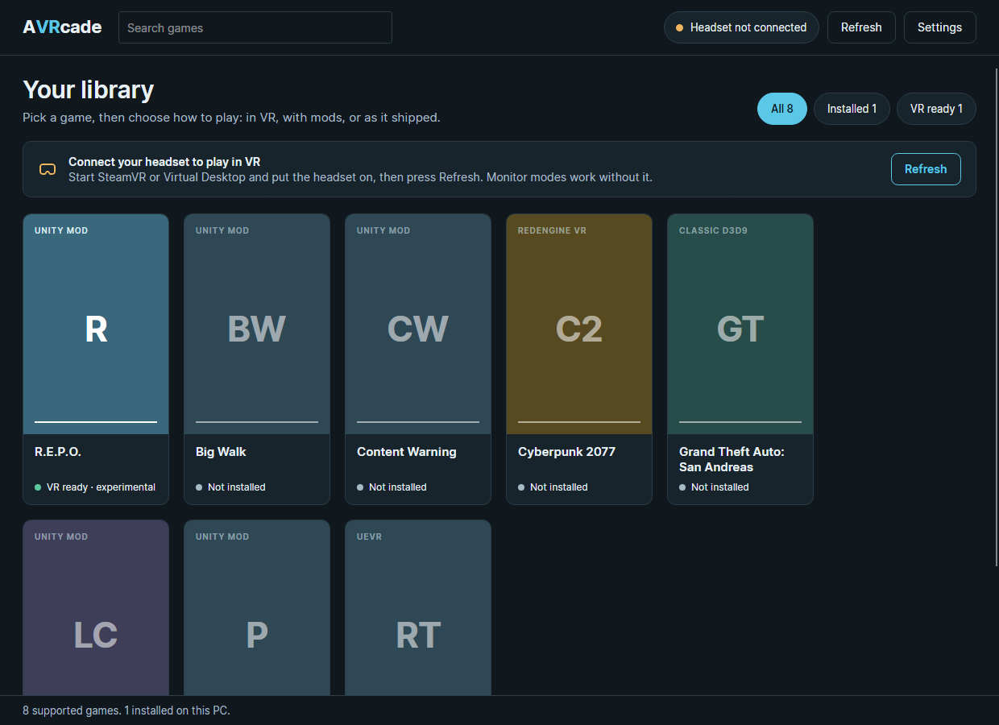

# AVRcade

Play PC games you already own in VR from one library.

## Install on Windows

**[Download the Windows installer](https://github.com/Axleonex/AVRcade/releases/latest/download/AVRcade-Setup.exe)**

[Portable ZIP](https://github.com/Axleonex/AVRcade/releases/latest/download/AVRcade-win-x64.zip) · [Checksums](https://github.com/Axleonex/AVRcade/releases/latest/download/SHA256SUMS.txt) · [Release notes](https://github.com/Axleonex/AVRcade/releases/latest)

1. Run `AVRcade-Setup.exe` and follow the installer.
2. Open **AVRcade** from the Windows Start menu.

Requires 64-bit Windows 10 (1809 or later) or Windows 11. The installer includes the .NET runtime and runs without administrator access.

**Updating?** Close AVRcade and run the latest installer. It reuses your installation folder and keeps your preferences.

**Using the portable ZIP?** Extract the entire archive into an empty folder and run `AVRcade.exe` there.

The installer is unsigned. If SmartScreen prompts you, verify the download against the published checksum before choosing **More info → Run anyway**.

## Play in VR

1. Install a supported game you own through Steam. See the game-specific steps below for other supported copies.
2. Connect your headset and start SteamVR or Virtual Desktop. Some games require SteamVR.
3. Open the game's page in AVRcade and choose **VR only**. Complete the setup shown on the button, then launch.

Choose **VR + mods** to play in VR with extra mods, **Mods, no VR** for modded monitor play, or **Vanilla** for the base game on your monitor. Each game's page shows which modes are available. Choose your mod manager or profiles in the **Mods** tab. [Mod manager setup](docs/onboarding/MOD-MANAGER-COEXISTENCE.md)



## Supported games

The library includes R.E.P.O., Lethal Company, PEAK, Content Warning, Big Walk, Escape the Backrooms, and *RV There Yet?*.

| Game | Extra setup |
| --- | --- |
| Titanfall 2 VR | Sign in to the EA app, start your OpenXR runtime, and choose **Launch in VR** in CircuitLord’s installer. The installer also detects EA app and Xbox copies. [Titanfall 2 setup](docs/release/WINDOWS-V0.5.8.md) |
| Cyberpunk 2077 | VR requires Cyberpunk 2.5. Follow the in-app Nexus prompt for More Occluders Scripted v0.3. [Cyberpunk setup and compatibility](docs/release/WINDOWS-V0.5.4.md) |
| YAPYAP | Prepare its VR package separately and start SteamVR, including when using Virtual Desktop. [YAPYAP package](mods/yapyap-vr/README.md) |
| GTA: San Andreas | Choose **Locate installed game** and select your classic PC installation. AVRcade checks the executable before installing the VR bridge. |

## Help

- If a game is missing, confirm Steam sees the installation and refresh the library. If launch is blocked, open **Troubleshooting → Run diagnostics** on that game's page.
- For mod updates, use **Update mods** where available. [Mod update guide](docs/app/MOD-UPDATES.md)
- For controller settings, open **Controls**. To record or stream, choose **Stream** on the game page. [OBS setup](docs/app/STREAMING.md)
- Use modded modes in private sessions with players who agree to it.

[Report a problem](https://github.com/Axleonex/AVRcade/issues)

## Build from source

Use the .NET 8 SDK to build, test, and run the app.

```powershell
dotnet build client/VrClient.sln -c Release
dotnet test client/VrClient.sln -c Release
dotnet run --project client/VrClient.App -c Release
```

[Windows packaging](docs/release/WINDOWS-V0.5.md) · [Add a game](docs/onboarding/ADD-A-GAME.md)

AVRcade is free and released under the MIT License. Each game page credits its VR mod authors. [MIT License](LICENSE) · [Third-party notices](THIRD-PARTY-NOTICES.md)
